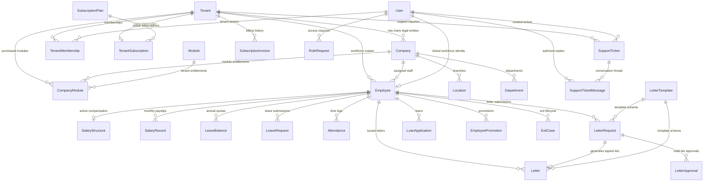

# HRMS Database Relationship Map

The system uses 109 interrelated Prisma models organized into domain clusters. Below is the structural mapping of the core entities and their relational integrity.

---

## Key Model Structures:

### 1. Tenancy & Organization
- `Tenant`: Multi-tenant boundary (`id`, `name`, `slug`, `status`, `databaseUrl`).
- `Company`: Legal business entity under a tenant (`id`, `tenantId`, `name`, `taxId`, `currency`).
- `TenantMembership`: Join entity linking `User` to `Tenant` with scoped role (`ADMIN`, `HR`, `FINANCE`, `MANAGER`, `STAFF`).

### 2. Commercial & Module Architecture
- `Module`: System capabilities (`id`, `key`, `name`, `category`, `isCore`, `isActive`).
- `CompanyModule`: Entitlement join table between `Tenant`, `Company`, and `Module` with status (`ENABLED`, `DISABLED`, `TRIAL`, `EXPIRED`) and JSON `config`.
- `SubscriptionPlan`: Packaging tiers (`id`, `name`, `slug`, `priceMonthly`, `priceAnnual`, `currency`, limits).
- `TenantSubscription`: Active commercial plan for a tenant.
- `SubscriptionInvoice`: Financial records linked to subscriptions and payment transactions.

### 3. Employee Master & Operations
- `Employee`: Complete employee record with dual lifecycle tracking (`lifecycle`: `PRE_JOINING` to `EXITED`, and `deletedAt` for legal record retention compliance).
- `SalaryStructure` & `SalaryRecord`: Configured salary components and generated payslips.
- `LeaveRequest` & `LeaveApproval`: Hierarchical workflow records.
- `LetterRequest` & `LetterApproval`: 4-step letter governance system.

