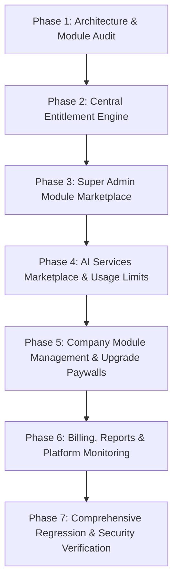

# HRMS Implementation Roadmap

This roadmap outlines the phased execution plan to transform IBM DigiTech Enterprise HRMS into an enterprise multi-company, multi-tenant SaaS platform with a Super Admin Module & AI Marketplace.

---

## Phased Execution Sequence:

### Phase 1: Complete Audit & Baseline Documentation (COMPLETED)
- Audited complete application stack (Next.js 16.1.1, React 19.2.3, Prisma 6.19.3, NextAuth v5).
- Created all 8 mandatory architecture and inventory artifacts.

### Phase 2: Central Backend Entitlement Service
- Create `lib/entitlements/engine.ts` providing `requireModuleEntitlement(tenantId, moduleKey)`.
- Enforce backend verification on server actions and API handlers.
- Create graceful `<ModulePaywall />` component for unpurchased features.

### Phase 3: Super Admin Module Marketplace
- Expand `Module` model in Prisma with pricing (`priceMonthly`, `priceAnnual`), features list, dependencies, trial duration, and published status.
- Build Super Admin Marketplace interface:
  - Add/Edit/Publish modules.
  - Configure monthly/annual pricing and trial periods.
  - Track revenue and subscribed companies per module.

### Phase 4: AI Services Marketplace & Commercial Controls
- Model `AIModule`, `AIUsageLog`, `AICompanyBudget`, and `AIProviderConfig`.
- Implement AI usage tracking (tokens and request counts) per company.
- Implement hard monthly budgets and prompt injection safeguards.
- Build `/super-admin/ai-services` and `/super-admin/ai-usage`.

### Phase 5: Tenant Module Management & Upgrade Portal
- Build `/company/modules` inside customer tenant dashboard.
- Display subscribed, trial, and available marketplace modules.
- Enable 1-click self-service trial activations and upgrade requests.

### Phase 6: Automated Billing, Invoicing & Financial Health
- Connect subscription renewals and invoice generation to active module subscriptions.
- Display company-level and platform-wide revenue breakdowns.

### Phase 7: Verification & Release Gates
- Full TypeScript compilation (`npx tsc --noEmit`).
- Production build verification (`npm run build`).
- Security, IDOR, and tenant isolation validation.

