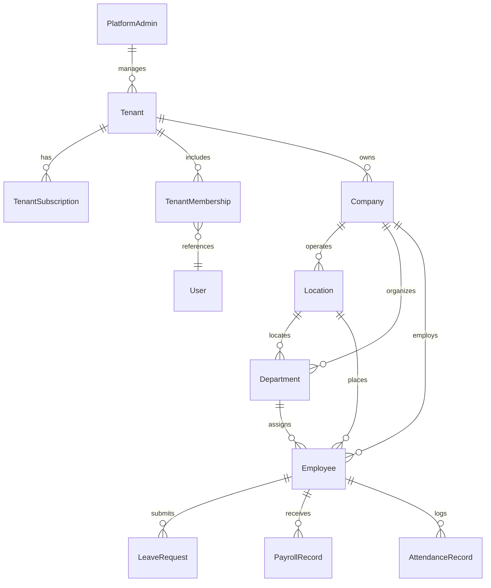

# System Architecture Document (Architecture)
## Multi-Tenant Multi-Company SaaS Platform

---

## 1. High-Level Architecture Overview

The system adopts a **Shared-Database, Shared-Process Multi-Tenant Architecture with Logical Separation**. This provides optimal cost-efficiency, simple operational overhead, and unified deployments while enforcing strict logical separation at the database and application layers.

```text
                                [ User / Browser ]
                                        │
                         https://acme.hrms-saas.com
                                        │
                                        ▼
                           [ Cloudflare / Reverse Proxy ]
                       (SSL Termination & Custom Domains)
                                        │
                                        ▼
                               [ Next.js Edge Proxy ]
                      (proxy.ts / Middleware Tenant Resolver)
                                        │
                   ┌────────────────────┴────────────────────┐
                   ▼                                         ▼
         [ Platform Admin App ]                    [ Tenant SaaS App ]
         (/platform-admin/**)                      (Dashboard, Modules)
                   │                                         │
                   └────────────────────┬────────────────────┘
                                        ▼
                           [ Server-Side Auth & RBAC ]
                       (Session + Tenant Membership Guard)
                                        │
                                        ▼
                       [ Tenant-Aware Prisma Client Extension ]
                        ($extends query wrapper auto-injecting
                         WHERE tenantId = session.tenantId)
                                        │
                                        ▼
                        [ PostgreSQL Managed Database ]
                         (Compound Indexes & Unique Keys)
```

---

## 2. Multi-Tenant Data Model & Hierarchy



### Core Entity Definitions:
1. **Tenant**: Root entity representing the paying customer account.
   - Fields: `id`, `name`, `slug`, `customDomain`, `status`, `branding` (JSON), `createdAt`, `updatedAt`.
2. **TenantMembership**: Links users to tenants with tenant-level authorization.
   - Fields: `id`, `tenantId`, `userId`, `role`, `status`, `joinedAt`.
3. **Company**: Represents a distinct business subsidiary under a tenant.
   - Fields: `id`, `tenantId`, `name`, `taxId`, `currency`, `logoUrl`, `isDefault`.
4. **Location**: Physical branch or office of a company.
   - Fields: `id`, `tenantId`, `companyId`, `name`, `code`, `city`, `country`, `timezone`.
5. **Department**: Organizational group.
   - Fields: `id`, `tenantId`, `companyId`, `name`, `code`, `parentId`.

---

## 3. Tenant Isolation & Security Boundary

### 3.1. Automatic Prisma Query Isolation (`lib/prisma.ts`)
To prevent developers from accidentally omitting `tenantId` in queries, a Prisma Client Extension (`$extends`) intercepts all read/write operations:

```typescript
// Conceptual Extension Pattern
export const getScopedPrisma = (tenantId: string) => {
  return prisma.$extends({
    query: {
      $allModels: {
        async findMany({ model, args, query }) {
          if (TENANT_SCOPED_MODELS.includes(model)) {
            args.where = { ...args.where, tenantId };
          }
          return query(args);
        },
        async create({ model, args, query }) {
          if (TENANT_SCOPED_MODELS.includes(model)) {
            args.data = { ...args.data, tenantId };
          }
          return query(args);
        }
      }
    }
  });
};
```

### 3.2. Compound Uniqueness Strategy
In a multi-tenant database, unique constraints must never be global:
- **Global**: `User.email` (for central identity across tenants).
- **Tenant-Scoped**:
  - `@@unique([tenantId, employeeCode])`
  - `@@unique([tenantId, companyId, documentReference])`
  - `@@unique([tenantId, userId])` (in `TenantMembership`)

---

## 4. Tenant Resolution Strategy

1. **Host Header Inspection**: `proxy.ts` parses incoming requests:
   - If hostname matches `*.hrms-saas.com`, extracts the subdomain as `tenantSlug`.
   - If hostname is a custom domain, looks up tenant by `customDomain` cache.
   - If hostname is `app.hrms-saas.com` or localhost without subdomain, reads session or header `x-tenant-id`.
2. **Request Context Injection**: The resolved `tenantId` and `tenantSlug` are attached to request headers:
   - `x-resolved-tenant-id`: validated tenant CUID.
   - `x-resolved-tenant-slug`: validated slug.
3. **Guard Verification**: Next.js Server Actions and API routes read headers/session and assert that the authenticated user possesses an active `TenantMembership` for that `tenantId`.

---

## 5. Storage & File Isolation

- Documents (resumes, passports, Emirates IDs, contracts, company policies) are stored in an S3-compatible object store or local disk storage.
- File paths are strictly prefixed by tenant ID:
  `storage/tenants/{tenantId}/documents/{companyId}/{employeeId}/{documentId}.pdf`
- Document serving routes authenticate the caller's tenant context before streaming file bytes.
